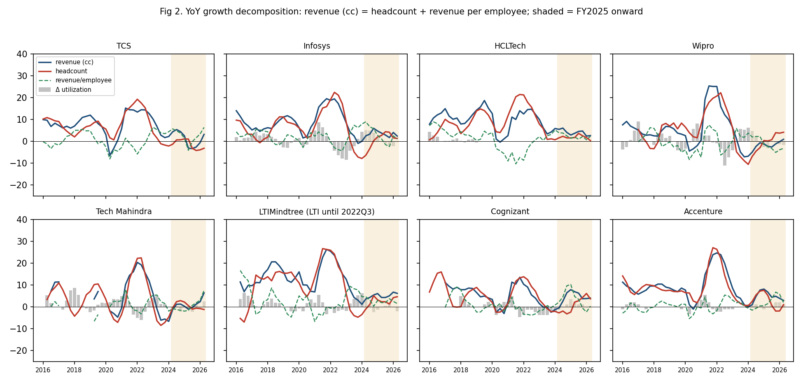
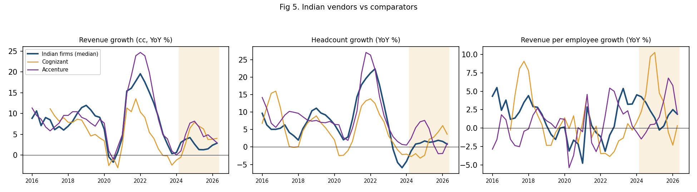
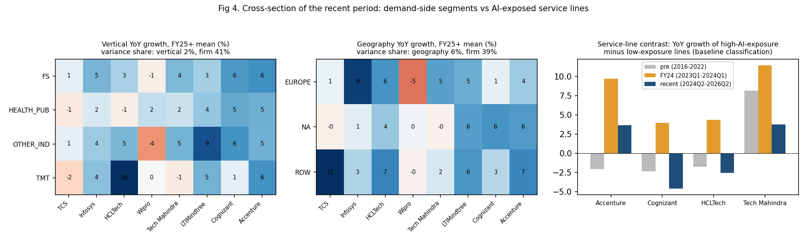
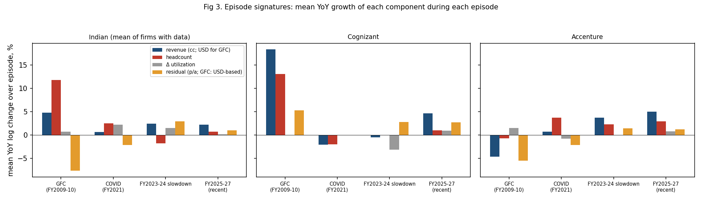
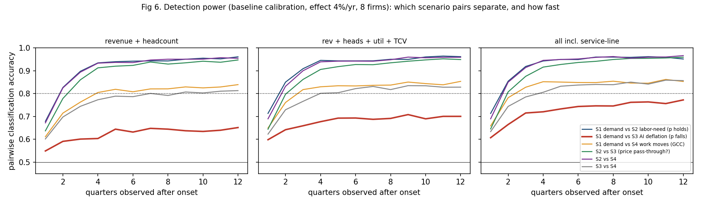
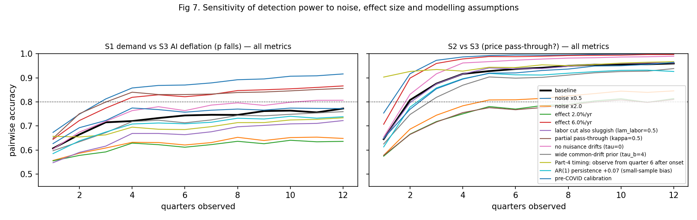
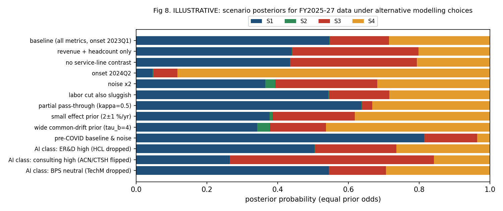
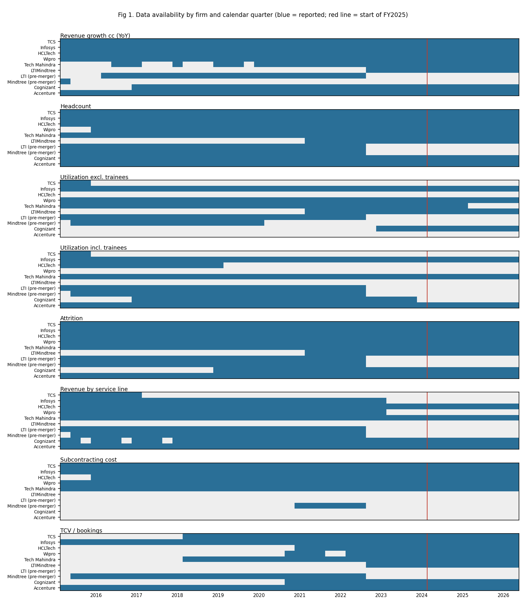
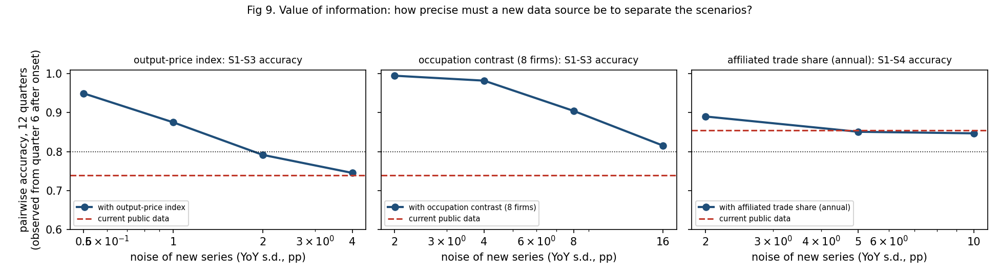

# Can public data tell why Indian IT-services headcount fell? — feasibility pilot

*Scope: TCS, Infosys, HCLTech, Wipro, Tech Mahindra, LTIMindtree; comparators Cognizant and Accenture. Quarterly data 2015–2026Q2 (Indian Q1FY27) from primary filings. Illustrative and descriptive; no causal claims.*

*Written 2026-09-27. Appendices: A. data coverage (formerly `AUDIT.md`); B. judgment calls and sensitivity (formerly `DECISIONS.md`); C. next steps after the pilot (formerly `NEXT_STEPS.md`).*

## 1. Verdict (read this first)

1. **Public data can separate "labor needs fell, prices held" (S2) from everything else, quickly.**
   - With revenue and headcount alone, the simulation reaches ≥95% pairwise accuracy within 2–3 quarters.
   - Applied to FY2025–27, **S2 gets ~0% posterior probability in every specification.**
   - Revenue per employee has not accelerated: Indian firms' mean YoY growth was +1.5% in FY25–27, against +0.9% (2015–22) or +1.7% (pre-COVID). A labor-saving shock with prices held would show up as faster revenue-per-employee growth.
2. **Public data cannot reliably separate a demand drop (S1) from AI-driven deflation passed into prices (S3).**
   - With full price pass-through, the two predict the same revenue and headcount paths.
   - Even with every public metric, the simulation plateaus at **~77% pairwise accuracy** and never reaches 80% within 12 quarters (65% with revenue and headcount only).
   - The only discriminating signals are the timing of utilization, the comparators' lower AI exposure, and a coarse service-line contrast available for 4 firms.
3. **"Work moves to client captives" (S4) is distinguishable from S1/S3 only through the comparators** (~85% accuracy after 3–4 quarters). That rests on the untestable assumption that Accenture and Cognizant don't lose work to GCCs too. Subcontracting data exist but are descriptive only.
4. **Applied to FY2025–27 (illustrative):**
   - The data are consistent with S1, S3 or S4.
   - The ranking flips with defensible choices: the AI-exposure classification of service lines, the onset date, and the calibration window.
   - **The sell-side S3 ("AI deflation") attribution is neither supported nor contradicted by public data.** The S3-vs-S1 log Bayes factor ranges from −3.1 to +0.8 across specifications. Without the service-line contrast it is about −0.2, i.e. uninformative.
5. **Time will not fix this.** Detection power plateaus after ~4–6 quarters, because persistent firm- and industry-specific drifts in demand don't average out. More quarters of the same metrics buy little.

**Implication for a full project:** it is worth doing only if it adds data that separate price per unit of *output* from volume, or data showing which kinds of task the cuts fall on. Hours and rate cards do not qualify; see the §6 correction. The ranked candidates are in Appendix C.

## 2. Data (details in Appendix A)

- **Collected:** 80k raw data points (incl. the GFC window) from ~1,200 distinct primary documents (fact sheets, SEC 6-K/8-K/10-Q/20-F, SEBI filings), each with a source URL. Nothing required a login.
- **Complete for all 8 firms:** revenue (reported and cc), headcount, attrition, vertical and geography mix.
- **Partial:** utilization is available for 6 of 8 firms in the recent window. **TCS stopped reporting it after FY16 and HCLTech after FY19.**
- **Service-line revenue — the most direct handle on AI exposure — has largely vanished:**
  - TCS stopped after FY17, Infosys after FY18, Wipro after FY23; LTIMindtree never reported it.
  - It survives only as coarse splits at HCLTech (IT&BS / ER&D / Software), TechM (IT / BPS), Cognizant (Consulting & Technology / Outsourcing) and Accenture (Consulting / Managed Services).
- **Missing entirely:** no firm publishes price, rate or billed-effort series, so **p and Q are never separately observed**.
- **Other gaps:** subcontracting cost exists for 5 Indian firms and neither comparator. Quantitative AI revenue exists for 1–4 quarters at 4 firms.

## 3. Historical decomposition (Part 2)

**Identity.** In YoY log changes: revenue growth (cc) = headcount growth + revenue-per-employee growth. Revenue per employee splits further into utilization change + a residual, where the residual = Δln p − Δln a. Price and labor-intensity changes are observationally mixed in that residual.



| mean YoY %, Indian firms | revenue cc | headcount | rev/employee | Δ utilization | residual (p/a) |
|--|--|--|--|--|--|
| 2015–22 (ex-COVID) | 12.2 | 11.8 | 0.9 | 0.2 | 2.0 |
| pre-COVID 2015–19 | 9.9 | 7.0 | 1.7 | 1.1 | 1.6 |
| COVID (2020Q2–Q4) | 0.6 | 2.5 | −1.8 | 2.2 | −2.2 |
| FY24 slowdown (2023Q1–2024Q1) | 2.4 | **−1.8** | **4.2** | 1.5 | 2.9 |
| FY25–27 (2024Q2–2026Q2) | 2.2 | 0.7 | 1.5 | 0.1 | 1.0 |
| *Accenture FY25–27* | *5.0* | *2.9* | *2.1* | *0.8* | *1.2* |
| *Cognizant FY25–27* | *4.6* | *1.0* | *3.6* | *0.9* | *2.7* |

**What the data are consistent with:**
- **The headcount decline is concentrated in FY24, not FY25–27.**
  - In FY24, Indian headcount fell ~2% YoY while revenue still grew ~2%. Utilization rose (+1.5 log points) and the residual jumped (+2.9).
  - This is the signature of absorbing slack after the FY22 hiring surge (headcount +20–30% YoY in 2021–22; Fig 2). It matches a demand normalization with labor hoarding unwinding. It is not a distinctive AI signature: the same pattern follows a hiring overshoot.
- **In FY25–27, revenue per employee grows at roughly its historical rate.** Headcount is roughly flat (+0.7%), while revenue growth is ~10 points below the 2015–22 average.
  - Within the identity, a slowdown this size with flat revenue per employee is what S1 (volume), S3 (price falls with labor needs) and S4 (volume moves elsewhere) all predict. S2 does not predict it.
  - Firm dispersion is large: Wipro −1.6% revenue and −1.5% revenue per employee; TCS revenue +1.1% and headcount −1.4%; LTIMindtree +5.1% revenue.
- **Past shocks.**
  - In the COVID shock (FY21), headcount kept growing and utilization rose, pushing the residual negative, with a small revenue drop.
  - FY24 shows the reverse sequence: headcount cut after the surge, with utilization and the residual rising.
  - The GFC signature (§3a) is different from both.
  - FY25–27 matches none of these: all components are quiet, and revenue growth is simply lower.
- **Comparators.** Before 2023, Indian median growth tracked Accenture closely (correlation 0.90 for revenue, 0.83 for headcount). In 2023–26 the correlations fall to 0.58 and 0.33.
  - Indian firms grew ~2–3 points slower than Accenture in FY25–27, versus about 1 point slower before 2023. A common-demand-only story (S1 hitting everyone equally) fits less well than one with an Indian-specific component. That component could be S4 (GCCs) or Indian vendors' higher exposure to AI-substitutable work (S3 with heterogeneous exposure).
  - Cognizant's recent growth includes ~4pp from the Belcan acquisition (2024Q4–25Q2), so its comparison is biased upward.



**Cross-sectional test (Fig 4).**
- **Verticals and geographies.**
  - Recent vertical growth is explained mostly by *firm* identity (41% of cross-firm × vertical variance) and hardly at all by vertical (2%).
  - The deceleration relative to 2017–19 has a modest geography component (22%): Europe and North America slowed more than the rest of world for several firms.
  - So declines do not line up by client industry across firms, which weakly argues against a pure industry-demand shock. Small n (24–32 cells) and 20+ segment reorganizations limit this test.
- **Service lines vs AI exposure** (baseline classification: run/maintain/BPO = high, consulting/ER&D = low). Relative to each firm's pre-2023 average, high-exposure lines slowed at:
  - Cognizant: −2.0 pts (biased by Belcan)
  - HCLTech: −0.8
  - TechM: −4.4 (noisy)
  - They *accelerated* at Accenture (+5.7). Managed Services outgrew Consulting as consulting demand fell.
  - With consulting classed as AI-exposed (alternative B), the Accenture and Cognizant signs flip. **Mixed, and classification-dependent.**



**Evidence bearing on S4 (descriptive).**
- Subcontracting cost as a share of revenue fell at every Indian firm from the FY22 peak to 2024 (e.g. HCLTech 15.0% to 13.0%, TechM 15.4% to 10.1%, TCS 10.0% to 4.7%).
- It has edged up since 2025 (HCLTech 14.8%, TechM 12.0%, TCS 6.0%, Infosys 8.5%), while headcount stayed flat or fell. That fits some substitution toward subcontractors, but levels remain below FY22.
- GCC headcount is not in any firm filing.

### 3a. GFC (FY2009–10) signature



- **Coverage.** The 2008Q3–2009Q4 window is covered for TCS, Infosys, HCLTech, TechM, Cognizant and Accenture. Wipro is dropped because its revenue perimeter changed in 2008. Only Infosys, HCLTech and Accenture report cc growth for this period, so revenue is shown in USD. USD strengthened sharply in 2008–09, so USD revenue growth understates cc growth.
- **Demand-shock pattern:**
  - Indian revenue growth collapsed from 25–30% YoY in 2007–08 to ~5% (USD).
  - Utilization dipped: Infosys troughed at −5.4 log points YoY, TechM −4.2, TCS −2.0.
  - Headcount growth slowed but stayed positive, at ~+12% on average.
  - Revenue per employee therefore fell (≈ −7% YoY in USD).
  - Accenture: revenue −0.5% cc (−4.7% USD), headcount −0.7%, utilization *up*. It trimmed staff faster.
- **Contrast with FY25–27.** The GFC signature is the textbook surprise-demand response in the model: utilization and revenue per employee fall first, headcount follows with a lag. FY25–27 shows neither the utilization dip nor falling revenue per employee.
  - A **sudden** demand drop like 2008–09 is therefore not what the recent data look like.
  - But at 6+ quarters after an onset, a *gradual* demand drift would also show no utilization dip. So this contrast rules out a GFC-style shock, not demand as such.
- **Caveats.** TCS (e-Serve/Diligenta, 2009Q1) and HCLTech (Axon, Dec 2008) acquisitions inflate headcount and revenue growth in this window.

## 4. Detection power (Part 3)

**Model** (`01_pilot/scripts/sim_model.py`). Each scenario is a persistent drift (% per year, starting at onset) in price p, volume Q or labor per unit a, mapped into YoY revenue, headcount, utilization, deal value, and the service-line contrast.
- **Timing:** surprise volume changes pass into headcount with partial adjustment, so utilization dips first. Anticipated labor-need changes (S2/S3) pass through immediately.
- **Nuisance drifts:** every scenario also allows a persistent common demand drift and firm-specific drifts, integrated out analytically.
- **Noise** (the part that matters most): calibrated from 2015Q2–2022Q4 excluding COVID quarters. Each metric's shocks are split into a component common to all firms and a firm-specific component, with cross-metric correlation, and each follows an AR(1) process.
  - YoY residual s.d.: revenue 3.7pp, headcount 5.5pp, utilization 2.7pp, TCV ~25pp, service-line contrast 7.5pp.
  - AR(1) ≈ 0.84–0.87 for revenue and headcount.
- **Simulation:** effect size 4%/yr (range 2–6), 2,000 Monte Carlo draws per cell, 8 firms, with each metric available only for firms that actually report it.

**Key table — pairwise accuracy at 12 quarters (quarters needed to reach 80%), baseline:**

| scenario pair | revenue only | revenue + headcount | + utilization + TCV | all incl. service-line | robust? |
|--|--|--|--|--|--|
| S1 demand vs **S2** labor need, p holds | 0.81 (10q) | **0.96 (2q)** | 0.96 (2q) | 0.95 (2q) | yes (≥0.82 in all sensitivities) |
| S2 vs **S3** (price pass-through) | 0.80 (10q) | **0.95 (3q)** | 0.95 (3q) | 0.96 (2q) | yes, except κ=0.5 (0.81, 10q) |
| S2 vs S4 | 0.86 (4q) | 0.95 (2q) | 0.96 (2q) | 0.97 (2q) | yes |
| S1 vs **S4** work moves (GCC) | 0.82 (5q) | 0.84 (4q) | 0.85 (3q) | 0.85 (3q) | fragile: fails at 2× noise or 2%/yr effect; depends on comparators being unaffected |
| S3 vs S4 | 0.79 (never) | 0.81 (7q) | 0.83 (4q) | 0.86 (4q) | fragile (same) |
| **S1 demand vs S3 AI deflation** | 0.58 (never) | **0.65 (never)** | 0.70 (never) | **0.77 (never)** | **not separable** except at 0.5× noise, 6%/yr effect, or partial pass-through |



- **Single metrics are weak.** Headcount alone, utilization alone or TCV alone never reach 80% for any pair (`01_pilot/output/key_table_compact.md`).
- **Four-way classification accuracy** (chance = 25%) plateaus at 69% with revenue and headcount and 76% with everything.
- **Sensitivity (Fig 7, `01_pilot/output/robustness_compact.md`).** S1–S3 accuracy moves as follows:
  - 0.77 at baseline
  - 0.65 with 2× noise
  - 0.64 with a 2%/yr effect
  - 0.87 with a 6%/yr effect
  - 0.86 with 50% pass-through
  - 0.73 when observing from quarter 6 after onset (the Part 4 situation)
  - 0.74 with the AR(1) coefficient corrected for its downward bias
  - 0.81 with no nuisance drifts
- **Which pairs stay indistinguishable with public data:** S1 vs S3 under all but optimistic assumptions. S1/S3 vs S4 if comparators are also exposed to GCC migration. Any pair at a 2%/yr effect, except those involving S2.



## 5. Applying the model to FY2025–27 (Part 4 — ILLUSTRATIVE)

**Setup:** onset at 2023Q1; observed quarters 2024Q2–2026Q2 (6–14 after onset); 258 firm-metric-quarter observations; deviations from each firm's 2015–22 mean; equal prior odds.

| specification | P(S1) | P(S2) | P(S3) | P(S4) | log BF S3:S1 |
|--|--|--|--|--|--|
| baseline (all metrics) | 0.55 | 0.00 | 0.17 | 0.29 | −1.2 |
| revenue + headcount only | 0.44 | 0.00 | 0.36 | 0.20 | −0.2 |
| no service-line contrast | 0.43 | 0.00 | 0.36 | 0.21 | −0.2 |
| AI class: consulting = high | 0.26 | 0.00 | **0.58** | 0.16 | +0.8 |
| onset 2024Q2 | 0.05 | 0.00 | 0.07 | **0.88** | +0.4 |
| pre-COVID baseline & noise | **0.81** | 0.00 | 0.15 | 0.04 | −1.7 |
| partial pass-through κ=0.5 | 0.64 | 0.00 | 0.03 | 0.33 | −3.1 |
| noise ×2 | 0.37 | 0.03 | 0.29 | 0.32 | −0.2 |



**Reading:**
- **S2 is rejected throughout.**
- **S1, S3 and S4 trade places** depending on choices the data cannot settle.
- **How much of the analysts' S3 attribution can public data support? Very little either way.**
  - The only evidence that bears on S3 specifically is the service-line contrast: 4 firms, 2–3 lines each.
  - Its direction depends on whether consulting counts as AI-exposed.
  - On aggregates alone the Bayes factor is ~1.
- **Posterior effect sizes:** 4.5–5.6%/yr under S1 or S3. The analysts' 3–5% deflation range is consistent with the data *if* S3 is assumed. The data do not favour assuming it.

## 6. What is and isn't identified; what would make the full project (not) worth doing

**Identified from public data:**
- Revenue vs headcount vs revenue per employee.
- Utilization for 6 of 8 firms.
- Whether revenue per employee accelerated. It did not, beyond FY24's utilization-driven jump, which rules out S2-type labor saving with prices held.
- Whether Indian firms diverged from comparators. They did, moderately, from 2023.

**Not identified:**
- Price vs volume (p vs Q). The residual of revenue per employee mixes price and productivity.
- Therefore S1 vs S3.
- GCC migration (S4) vs vendor-specific volume loss, beyond the comparator contrast.

**The full project is not worth doing if it only extends these public series.** Power plateaus within ~6 quarters. Service-line and utilization disclosure has been shrinking, not growing. Conclusions flip on a classification judgment.

**It becomes worth doing if at least one of these can be obtained.**

Correction (added after the pilot): billed effort = u·L = a·Q. So hours, person-months and revenue per billed hour (rate cards) measure a·Q and p/a, **not** Q and p. Under full pass-through, S1 and S3 produce identical revenue, effort and hourly-rate paths. Effort or rate data therefore sharpen the utilization split but **cannot** separate S1 from S3. What can:

1. **Prices per unit of *output*:**
   - fixed-price or managed-service pricing per unit of scope (per ticket, per transaction, per application)
   - output-based official price indices, if their pricing method is per deliverable
2. **Where the cuts fall across tasks.** Headcount or hiring by occupation or role within firms, crossed with occupation-level AI exposure. S2/S3 predict cuts concentrated in exposed occupations; S1 predicts cuts spread by client demand.
3. **Client-side output volumes** (transactions processed, applications maintained). These are rarely public.
4. **For S4:** affiliated vs unaffiliated services trade from India, and GCC headcount by parent company.

Appendix C screens these candidates with user avatars, feasibility probes and a value-of-information simulation.

**Main caveats:** Part 4 is illustrative; five judgment calls drive it (Appendix B, top 5). All comparisons are descriptive.

---
*Reproduce:*

```bash
cd 01_pilot/scripts && python 01_build_tidy.py && python 02_audit.py && python 03_part2.py && python 05_part3_simulation.py && python 05b_part3_tables.py && python 06_part4_apply.py
```

*Raw data extraction scripts are in `scripts/extract/`.*

---

## Appendix A. Data coverage (formerly AUDIT.md)

**Scope.** 6 Indian firms (TCS, Infosys, HCLTech, Wipro, Tech Mahindra, LTIMindtree, plus pre-merger LTI and Mindtree), 2 comparators (Cognizant, Accenture). Calendar 2015Q2 – 2026Q2 (Indian Q1FY16 – Q1FY27; Accenture Q3FY15 – Q3FY26; Accenture's Q4FY26 comes out 1 Oct 2026), plus the GFC window 2007Q1–2012Q1 (§A.5).
**Raw data.** 80k rows in `data/raw/<firm>.csv` and `gfc.csv`, each with a primary-source URL. Every vintage is kept, i.e. the same quarter as printed in each later release. The tidy panel (`data/tidy/panel_long.csv`) keeps the latest vintage. It has 37k firm × quarter × metric × dimension cells, and 1,023 of them were restated across vintages.
**Sources.** IR fact sheets and data sheets, earnings releases, SEC EDGAR (Infosys/Wipro 6-K and 20-F; Cognizant/Accenture 8-K, 10-Q and 10-K), and SEBI/NSE results filings. Company-hosted call transcripts are used only for metrics disclosed nowhere else (Accenture utilization/attrition/GenAI, some TCV). No news or aggregator figure is used as data.

### A.1 Coverage matrix

Cell = share of quarters with data, **FY16-onward / recent window (2024Q2–2026Q2, 9 quarters)**. "—" = never reported in the period. Pre-merger LTI/Mindtree show one share (their series end in 2022Q3). The full firm × metric table with first and last quarters is in `01_pilot/output/coverage_matrix.csv`; the quarter-by-quarter view is Fig 1.

| metric | TCS | Infosys | HCLTech | Wipro | TechM | LTIM | LTI | Mindtree | Cognizant | Accenture |
|:--|:--|:--|:--|:--|:--|:--|:--|:--|:--|:--|
| Revenue USD | 100/100 | 100/100 | 100/100 | 100/100 | 100/100 | 100/100 | 100 | 100 | 100/100 | 100/100 |
| Revenue growth cc (YoY) | 100/100 | 100/100 | 100/100 | 100/100 | 73/100 | 71/100 | 87 | 3 | 84/100 | 100/100 |
| Revenue growth cc (QoQ) | 53/44 | 100/100 | 100/100 | 100/100 | 80/100 | 100/100 | 87 | 40 | — | — |
| Revenue by vertical | 100/100 | 100/100 | 100/100 | 100/100 | 100/100 | 100/100 | 100 | 97 | 100/100 | 100/100 |
| Revenue by geography | 100/100 | 100/100 | 100/100 | 100/100 | 100/100 | 100/100 | 100 | 97 | 100/100 | 100/100 |
| **Revenue by service line** | 18/**0** | 71/**0** | 100/100 | 71/**0** | 100/100 (IT vs BPS only) | — | 100 | 97 | 93/100 (2 lines) | 100/100 (2 lines) |
| Headcount | 100/100 | 100/100 | 100/100 | 93/100 | 100/100 | 100/100 | 100 | 100 | 100/100 | 100/100 |
| Net additions | 84/33 | 36/0 | 56/100 | — | — | — | — | 63 | 38/78 | — |
| Fresher hires | 24/0 | — | 44/100 | — | — | — | — | — | — | — |
| Attrition | 100/100 | 100/100 | 100/100 | 100/100 | 100/100 | 100/100 | 100 | 100 | 67/100 | 100/100 |
| **Utilization excl. trainees** | 7/**0** | 100/100 | **—** | 100/100 | 89/44 | 100/100 | 100 | 63 | 31/100 | — |
| Utilization incl. trainees | 7/0 | 100/100 | 36/0 | — | 100/100 | — | 100 | 97 | 62/0 (offshore) | 100/100 |
| Subcontracting cost | 100/100 | 100/100 | 93/100 | 100/100 | 100/100 | — | — | 23 | — | — |
| TCV / bookings | 73/100 | 100/100 | 49/100 | 47/100 | 73/100 | 71/100 | — | 97 | 51/100 | 100/100 |
| Client buckets | 100/100 | 100/100 | 100/100 | 100/100 | 100/100 | 100/100 | 100 | 100 | 13/0 | 29/100 |
| Onsite/offshore mix | — | 100/100 | — | 100/100 | 100/100 | 100/100 | 100 | 80 | — | — |
| AI disclosure (any number) | 7/33 | 7/22 | 9/44 | 16/44 | 4/22 | — | — | — | 7/22 | 22/78 |



### A.2 Key gaps

1. **Utilization is missing for the two largest-by-headcount firms (TCS, HCLTech) in the recent window.** TCS stopped reporting it after Q3FY16 and HCLTech after Q4FY19; no later call transcript gives a number. Cognizant's measure changes in 2023/24 (offshore → blended). TechM's excluding-trainees measure stops after FY25; its including-trainees series is used instead. Recent-window utilization is therefore available for 6 of 8 firms: Infosys, Wipro, TechM, LTIM, Cognizant, Accenture.
2. **Service-line revenue has effectively disappeared for Indian firms.**
   - TCS stopped after Q4FY17, Infosys after Q4FY18, Wipro after Q4FY23; LTIMindtree never reported it.
   - In the recent window only 4 firms have any split, all coarse:
     - HCLTech: IT & Business Services / Engineering and R&D / Software
     - TechM: IT / BPS
     - Cognizant: Consulting & Technology / Outsourcing
     - Accenture: Consulting / Managed Services
   - This is the metric most directly tied to AI task exposure.
3. **No firm reports price, rate cards, billed hours or effort volume** in the recent window. Infosys' onsite/offshore person-months stop after Q4FY18. **p and Q are never separately observed.**
4. **Deal value (TCV) definitions differ by firm** (large deals only vs all deals, net-new vs incl. renewals). Before about 2019–21, figures are often hand-entered from calls. The series is very noisy: the YoY residual s.d. of trailing-12-month TCV is about 22%.
5. **Fresher hiring:** only HCLTech reports it consistently (from FY22). TCS stopped after FY18, and the others don't report it.
6. **Subcontracting cost:** available for 5 Indian firms (not LTIMindtree, which has only 9 Mindtree quarters) and neither comparator. It is an INR cost line; the share of revenue is computed in `01_build_tidy.py`. TCS's line switches to an expense-by-nature definition at Q1FY27, a break.
7. **AI revenue:** quantitative AI revenue exists only for:
   - Accenture: GenAI bookings/revenue, Q4FY23–Q1FY26, then discontinued
   - HCLTech: advanced-AI revenue from Q2FY26
   - TCS: AI run-rate from Q3FY26
   - Infosys: AI share of revenue, Q3FY26 and Q1FY27

   That is 1–4 quarters per firm, too short for any time-series use.

### A.3 Definitional breaks (details in `data/raw/<firm>_NOTES.md`)

| firm | break | quarter | handling |
|--|--|--|--|
| TCS | service lines dropped; vertical recasts (FY18 "Regional Markets", FY20, FY24 "Consumer Business") | Q1FY18; Q1FY20; Q2FY24 | vertical growth rates used as reported; mapped to 4 broad groups |
| TCS | subcontracting line moves to expense-by-nature | Q1FY27 | flagged; one quarter only |
| Infosys | attrition definition changes 3× (LTM excl. subs → annualized → voluntary annualized → voluntary LTM, IT services) | FY16, FY21, FY22 | attrition not used in the model |
| Infosys | vertical reorganization (8 segments, FY18 restated) | Q1FY19 | as above |
| HCLTech | FY ended June until FY15; FY16 was a 9-month transition year | 2015–16 | calendar mapping by period_end |
| HCLTech | service lines → segments (ITBS/ERS/Products & Platforms); software moved to HCLSoftware; mix switched to Services level | Q1FY20; Q1FY23 | pre-FY20 ER&D stored under a separate name (not comparable) |
| HCLTech | divestiture removed 7,398 employees | Q1FY25 | headcount YoY base adjusted by the reported number (D10) |
| HCLTech | attrition IT-services LTM → company LTM excl. BPO; utilization discontinued | Q1FY20; after Q4FY19 | — |
| Wipro | headcount definition ("IT services head count" → "employee count", ~16k lower) | Q4FY17 | new series only from Q4FY16 (no splice) |
| Wipro | IT services segment perimeter (ISRE out Q3FY19, back Q1FY25); Capco acquisition | Q3FY19, Q1FY25; Q1FY22 | revenue growth used as reported (includes inorganic) |
| Wipro | geography and vertical reorganizations (6 vertical, 4 geography changes) | various | broad grouping |
| TechM | vertical reclassifications | Q1FY22, Q1FY24, Q4FY25 | broad grouping |
| TechM | onsite/offshore mix switches from revenue to headcount basis | Q1FY23 | not used |
| LTIMindtree | merger; combined restated data only from Q1FY22; combined headcount ~3% below LTI+Mindtree sum; utilization definitions differ | Q3FY23 (restated to Q1FY22) | **no splice**: LTI and Mindtree enter calibration as separate firms; LTIM only from Q1FY22 (D9) |
| Cognizant | segment renames; ASC 606; bookings definition; attrition definition (2023, 2026 with recast); utilization offshore → blended; Belcan acquisition (~4pp growth, 2024Q4–2025Q2) | 2017Q1; 2018; 2021Q4; 2023Q1/2026Q1; 2024Q1; 2024Q3 | utilization YoY computed within each series; Belcan not adjusted (D12) |
| Accenture | ASC 606 (revenue incl. reimbursements from FY19); geography reorganized 4×; Outsourcing → Managed Services; GenAI → "Advanced AI" | Q1FY19; FY18/20/24/25; Q1FY23; Q1FY26 | cc growth as reported; type-of-work series treated as continuous |

### A.4 Access log

- **Blocked but obtained another way:**
  - tcs.com: HTTP 403 to scripts; PDFs downloaded through the in-app browser.
  - infosys.com: 403; archived copies of the original PDFs taken from web.archive.org, with the original URL recorded.
  - investors.cognizant.com: 403; SEC EDGAR used instead.
- **Blocked with no alternative needed:**
  - BSE API: "Access Denied".
  - web.archive.org was down during the LTIMindtree collection; NSE filings used instead.
- **Nothing required a login or payment.** Paywalled transcript sites (Seeking Alpha etc.) were not used.
- **Image-only PDFs** (TechM, HCLTech SEBI filings, Cognizant slide images) were OCR'd or hand-entered. Those values are flagged `hand-entered` in `notes` and were checked against other vintages.
- **Spot checks:** each collection agent re-checked ≥10 random values against the source text; all matched after one parsing fix (LTI Q4FY19).

### A.5 GFC window (2007–2012)

The data are in `data/raw/gfc.csv` (11.3k rows; notes in `gfc_NOTES.md`). EDGAR supplied Infosys, Wipro, Cognizant and Accenture. web.archive.org copies of the companies' own PDFs supplied TCS, HCLTech and TechM (tcs.com and BSE blocked scripts). Quarters covered, out of 21 (2007Q1–2012Q1):

| metric | TCS | Infosys | HCLTech | Wipro | TechM | Cognizant | Accenture |
|--|--|--|--|--|--|--|--|
| Revenue USD | 21 | 21 | 21 | 21 (total, not IT Services) | 21 | 21 | 21 |
| cc growth | 2 | 21 | ~18 | 2 | — | — | 21 |
| Headcount | 21 | 21 | 21 | 21 | 21 | 18 | 16 |
| Utilization | 21 | 21 | 21* | ~14 | 21 | — | 17 |
| Attrition | 21 | 21 | 21 | 6 | 12 | 21 | 21 |

\*HCLTech GFC utilization is reported only for its software-services business (offshore/blended), not company-wide, so it isn't used in Part 2.

**Breaks:**
- Wipro: IT Services perimeter changed in Q1FY09.
- Infosys: US GAAP → IFRS in Q2FY09.
- HCLTech: June fiscal year; Axon consolidated from Dec 2008.
- TCS: e-Serve and Diligenta added to headcount in 2009Q1.
- TechM: Satyam not consolidated in this window.
- Accenture: Health & Public Service created in FY10.

**Verdict:** revenue, headcount and utilization are enough for a descriptive GFC signature (§3a of the main report). They are not enough for noise calibration: 2012Q2–2015Q1 is not collected, and definitions differ from the post-2015 data.

### A.6 Feasibility verdict

| use | verdict |
|--|--|
| **Revenue (cc) × headcount decomposition**, all 8 firms, 2016–2026 | **Usable.** Complete for every firm, apart from gaps in cc growth for TechM and Mindtree before 2019. |
| **Utilization split of revenue per employee** | **Partly usable.** 6 of 8 firms in the recent window; missing for TCS and HCLTech, the largest firm and one of the three largest. Definitions differ across firms (including vs excluding trainees, IT services only), so only within-firm changes are comparable. |
| **Vertical / geography cross-section** | **Usable** after mapping to 4 broad vertical groups and 3 regions; reorganizations make fine-grained comparisons unreliable. |
| **Service-line (AI-exposure) cross-section** | **Barely usable.** 4 firms with 2–3 coarse lines each; no Indian pure-play split except HCLTech and TechM. Parts 2–4 use it only as one weak signal. |
| **Subcontracting (bears on S4)** | **Descriptive only.** 5 Indian firms, no comparators. |
| **Deal value** | **Usable but very noisy**; definitions not comparable across firms (used only as YoY within firm). |
| **Price vs volume** | **Not identified.** No public series separates p from Q. The residual of revenue per employee after utilization mixes price and labor intensity. |

**Bottom line.** Parts 2–4 are feasible for the aggregate identity (revenue, headcount, and utilization for 6 of 8 firms). The cross-sectional test in service lines, which is the most direct evidence on AI exposure, has to be scaled down to four firms with coarse splits. Per the brief, it is used as a weak signal and not worked around with assumptions.

---

## Appendix B. Judgment calls, alternatives, sensitivity (formerly DECISIONS.md)

Sensitivity key:
- **HIGH**: changes a headline conclusion.
- **MED**: moves numbers but not conclusions.
- **LOW**: negligible or untested but expected small.

The numbers quoted come from `01_pilot/output/robustness_compact.md` (Part 3) and `01_pilot/output/part4_table.md` (Part 4).

---

### Top 5 for review

#### D1. What separates S1 (demand drop) from S3 (AI deflation with price pass-through) in the model — HIGH
- **Choice.** At the firm level, S1 and S3 predict the same revenue and headcount paths once full pass-through is assumed (κ=1). The model therefore separates them through only three channels:
  - **(a) Timing.** Demand shocks are surprises: headcount adjusts with lag λ=0.5 per quarter, so utilization dips first. Labor-need cuts are anticipated and pass straight into headcount with no utilization dip (λ_labor=1).
  - **(b) Comparator exposure.** Accenture's AI-exposure loading is 0.7, while S1 hits all firms equally.
  - **(c) Service-line contrast.** Only S3 predicts that high-AI-exposure service lines slow relative to low-exposure ones.
- **Alternatives.**
  - Treat labor-need cuts as sluggish too (λ_labor=0.5). This removes channel (a).
  - Equal exposure for all firms. This removes channel (b).
  - Partial pass-through, κ=0.5.
- **Sensitivity.**
  - Part 3: S1-vs-S3 accuracy at 12 quarters is 0.77 at baseline, 0.72 with λ_labor=0.5, and 0.86 with κ=0.5.
  - Channel (a) matters only in the first 4–5 quarters after onset. Observed from quarter 6 onward (the Part 4 situation), accuracy is 0.73.
  - Part 4 (quarters 6–14) therefore rests almost entirely on (b) and (c).
- **Why it matters.** Anyone who rejects these three channels should read S1 vs S3 as **not identified** from public firm data.

#### D2. AI-exposure classification of service lines — HIGH (Part 4), MED (Part 3)
- **Choice (baseline).** Classified *high*:
  - Accenture Managed Services (formerly Outsourcing)
  - Cognizant Outsourcing
  - HCLTech IT & Business Services
  - TechM BPS

  Classified *low*: Accenture/Cognizant Consulting (& Technology), HCLTech Engineering & R&D. HCLSoftware is excluded as product revenue.
- **Rationale.** Run and maintain work, application management, testing and BPO are dominated by codifiable tasks: coding, documentation, ticket resolution, transaction processing. Task-exposure studies (e.g. Eloundou et al. 2023) rate these highest. Engineering R&D is tied to physical products. Consulting is relationship- and judgment-heavy.
- **Alternatives.**
  - (A) ER&D counted as high, since it is software-engineering heavy. HCLTech then drops out.
  - (B) Consulting counted as high, since GenAI exposure of analyst and knowledge work is also high. The Accenture and Cognizant contrasts flip sign.
  - (C) BPS counted as neutral. TechM drops out.
- **Sensitivity (Part 4).**
  - Baseline: P(S1)=0.55, P(S3)=0.17.
  - Alternative A: 0.50 / 0.23.
  - **Alternative B: 0.26 / 0.58.** The S1 lean flips to S3.
  - Alternative C: 0.54 / 0.16.
- **Why it matters.** The only evidence in public data that bears directly on S3 hinges on a contestable classification.

#### D3. Noise-calibration window — MED (Part 3), HIGH (Part 4)
- **Choice.** Per the brief, 2015Q2–2022Q4, excluding YoY quarters distorted by COVID (2020Q2–2021Q2). This window includes the FY22 hiring boom and its unwinding, which inflate "normal" volatility and the baseline growth means.
- **Alternative.** Pre-COVID only (2015Q2–2020Q1).
- **Sensitivity.**
  - Part 3: S1–S3 accuracy is barely changed (0.77 in both). S1–S4 goes from 0.85 to 0.89.
  - Part 4: P(S1) goes from 0.55 to 0.81, because the pre-COVID baselines are lower and the noise smaller.
- **Related fix (see D19).** An earlier run gave P(S1)=0.99 under this alternative. That came from a spurious cross-firm "common" component in the service-line contrast, estimated from 3 firms. That component was removed.

#### D4. Nuisance drifts (the main cap on detection power) — HIGH
- **Choice.** Every scenario allows two persistent drifts in demand that are unrelated to the scenario:
  - A common drift across firms, b ~ N(0, τ_b²). τ_b = 1.45%/yr, calibrated as the s.d. of annual cross-firm median growth in calm pre-2023 years.
  - A firm-specific drift, h_f ~ N(0, τ_h²), with **τ_h = 2%/yr by judgment**. The data do not identify it: the sampling-corrected estimate is 0, the uncorrected s.d. of firm-relative drift changes is 3.0%/yr, and it is confounded with Wipro's Capco acquisition.
- **Alternatives.** τ = 0 (no nuisance drift); τ_b = 4.
- **Sensitivity.**
  - Part 3: with τ=0, S1–S4 goes from 0.85 to 0.98 and S1–S3 from 0.77 to 0.81. With τ_b=4 there is little change.
  - Part 4: with τ_b=4, P(S4) goes from 0.29 to 0.46.
- **Why it matters.** Persistent drifts do not average out, which is why accuracy plateaus after about 4–6 quarters. More quarters of the same public metrics buy little.

#### D5. Part 4 onset quarter and baseline — HIGH
- **Choice.** Onset at 2023Q1: the first quarter of falling headcount, i.e. the start of the FY24 slowdown. FY2025–27 data (2024Q2–2026Q2) are quarters 6–14 after onset. Baseline = each firm's mean YoY growth in 2015Q2–2022Q4 (ex-COVID), requiring ≥8 quarters. LTIMindtree uses the average of LTI and Mindtree.
- **Alternatives.**
  - Onset at 2024Q2 (i.e. FY25 treated as a new shock).
  - A pre-COVID baseline (see D3).
- **Sensitivity.** With onset at 2024Q2, P(S4) goes from 0.29 to 0.88. Treated as a fresh shock, the large Indian-vs-comparator gap in 2024Q2–2025Q1 looks like Indian-specific volume loss.
- **Why it matters.** Part 4 results should be read as illustrative only.

---

### Data decisions

| # | decision | alternatives | sensitivity |
|--|--|--|--|
| D6 | **All metrics as YoY log changes (×100).** Revenue = firm-reported constant-currency YoY growth. Headcount = YoY log change of end-of-period headcount. Utilization = YoY log change within one series. | QoQ cc growth: TCS gives no QoQ cc for most of FY22–26, Accenture reports YoY only. QoQ USD growth: FX-contaminated, and Accenture is ~50% non-USD. | MED. YoY removes seasonality but makes noise highly autocorrelated (ρ≈0.85), which is modelled explicitly. |
| D7 | **Accenture quarters assigned to the calendar quarter of their end month** (Nov→Q4, Feb→Q1, May→Q2, Aug→Q3). | Interpolate to calendar quarters. Rejected: it fabricates data. | LOW. A one-month offset on a smooth YoY series. |
| D8 | **Latest vintage wins** when a figure was restated (917 of 32k cells). All vintages are kept in `data/raw`. | First-reported values. | LOW for totals (revenue/headcount rarely restated). MED for segment shares after reorganizations. |
| D9 | **LTIMindtree is not spliced.** LTI and Mindtree enter the pre-2023 calibration as separate firms; LTIMindtree enters from Q1FY22 (the restated combined series). | Sum LTI+Mindtree (combined headcount is 3% lower than the sum; utilization definitions differ); or drop LTIM. | LOW. LTIM is 1 of 8 firms in Parts 3–4. |
| D10 | **HCLTech Q1FY25 divestiture:** the reported 7,398 divested employees are subtracted from the base of YoY windows spanning it. | Leave unadjusted (HCL headcount growth would be understated by ~3pp for 4 quarters). | LOW. |
| D11 | **One utilization series per firm, chosen by longest consistent coverage:** <br>• excluding trainees: TCS, Infosys, Wipro, LTI, LTIM <br>• including trainees: HCLTech, TechM, Mindtree, Accenture (definition unstated) <br>• Cognizant: offshore utilization through 2023, then blended; YoY changes computed within each series and spliced at the change level. | Excluding trainees everywhere (TechM's series stops after FY25). | LOW–MED. Utilization is missing for TCS and HCLTech in the recent period regardless. |
| D12 | **Acquisitions not adjusted:** Wipro–Capco (2021), HCL–IBM products (2019), Cognizant–Belcan (~4pp of growth, 2024Q4–2025Q2). Reported cc growth includes inorganic revenue. | Subtract disclosed inorganic contribution where available. | MED for Cognizant's recent growth; biases its service-line contrast toward S3 (Belcan sits in engineering/consulting). |
| D13 | **Verticals mapped to 4 broad groups** (financial services; tech/media/telecom; health & public; other industry, incl. manufacturing, consumer, resources and Accenture "Products"). **Geographies mapped to 3 regions** (North America incl. "Americas"; Europe incl. UK and EMEA; rest of world). Keyword rules are in `03_part2.py`. | Finer mapping: impossible to keep consistent through 20+ reorganizations. | MED for the cross-section; Accenture "Products" and TechM "Others" are rough fits. |
| D14 | **Subcontracting share = INR subcontracting cost / INR consolidated revenue.** For TCS: USD "fees to external consultants" (cost-of-revenue + SG&A lines) / USD revenue. | Report levels only. | LOW. Descriptive only. TCS's Q1FY27 definition break is flagged. |
| D15 | **Deal value:** trailing-4-quarter sum of the reported quarterly figure, then YoY. The measure differs by firm: <br>• Wipro: large deals (bookings start only in FY23) <br>• Cognizant: reported trailing-12-month bookings <br>• Accenture: new bookings <br>• others: total/large-deal TCV as defined by each firm | Exclude TCV. | LOW. TCV adds little power; noise s.d. ~25%. |
| D16 | Wipro revenue = **IT Services segment** (USD), not consolidated. | Consolidated INR. | LOW. |
| D17 | Revenue per employee uses **end-of-period** headcount. | Average of opening and closing headcount. | LOW for YoY changes. |
| D18 | Missing cc growth (e.g. Mindtree, TechM before 2019) is **left missing**, not replaced by USD growth. | Fill with USD growth. Rejected: that mixes FX into the series. | LOW. It reduces the calibration sample. |
| D24 | Infosys fact sheets taken from **Wayback Machine copies** of the original infosys.com PDFs (the site blocks scripts). The original URL is recorded as source_url; the archive timestamp is in source_doc. | Skip the fact sheets. That would lose utilization, segments and client buckets. | LOW. They are byte copies of the primary documents. |

### Model decisions (Parts 3–4)

| # | decision | alternatives | sensitivity |
|--|--|--|--|
| D19 | **Service-line contrast (SLc) has no cross-firm common component**; its estimated common variance is moved to the firm-specific part. Rationale: a within-firm difference has no reason to co-move across firms. The pre-COVID estimate (3 firms) produced a spurious 0.8 correlation with common revenue shocks. | Estimate a common component as for the other metrics. | HIGH. The fix moved pre-COVID Part 4 from P(S1)=0.99 to 0.81, and baseline Part 4 from (S1 0.43, S3 0.36) to (S1 0.55, S3 0.17). The baseline shift comes from the SLc signal now being weighed as firm-specific evidence. |
| D20 | **Linear-Gaussian scenario models** with closed-form marginal likelihood; scenarios specified as persistent drifts (%/yr) starting at onset. | Nonlinear state space with MCMC; one-off level shocks. | MED. Drift shapes are identical across scenarios by construction, so separation never comes from assumed shape differences. |
| D21 | **Effect-size prior:** d ~ N(4, 2²) %/yr under every scenario, informed by analyst "3–5% deflation" talk; this is not data. The simulated truth uses d = 2, 4 or 6. | Scenario-specific priors. | HIGH for power. At d=2%/yr, no pair except S1–S2 and S2–S3/S2–S4 reaches 80%. |
| D22 | **S3 pass-through κ=1** (price falls one-for-one with labor per unit). | κ=0.5. | MED. Partial pass-through makes S3 easier to tell from S1 and harder to tell from S2. |
| D23 | **Partial adjustment speed λ=0.5 per quarter** for surprise volume changes. | 0.3 or 0.7. | MED. It only affects the first ~4 quarters. |
| D25 | **S4 modelled only as the GCC variant**: volume falls for Indian vendors only; comparators are unaffected. The subcontractor variant is not modelled; subcontracting is shown descriptively. | Comparators also partially affected (Accenture/Cognizant also lose work to GCCs). | HIGH for S4 identification. If comparators also lose work, S4 collapses into S1. |
| D26 | **Firm AI-exposure loading:** 1.0 for Indian vendors and Cognizant, 0.7 for Accenture (consulting-heavy mix). Exposure gap between service-line groups `dexp`=0.5. | Equal loadings. | MED. This is channel (b) in D1. |
| D27 | **Noise:** each metric follows an AR(1) process, and its shocks are split into a common part (the cross-firm mean each quarter) and a firm-specific part, with correlations across metrics. After the code review: firm-specific variance is rescaled by n/(n−1), and the full firm-specific covariance / n is subtracted from the common part. | Independent across firms (would overstate power, since firms share shocks). | MED. The AR(1) coefficients are likely biased down (~0.07); a +0.07 sensitivity lowers S1–S3 accuracy from 0.77 to 0.74. |
| D28 | **Accuracy metric:** pairwise, equal prior odds, ties (identical predictions) split evenly. "Separates" = ≥80% accuracy. | Threshold of log BF > log 10. | LOW. Both are reported (`E_logBF`, `P_strong` in `01_pilot/output/sim_results.csv`). |
| D29 | **Firms available per metric in the simulation** = firms with ≥6 of 9 recent quarters of data: <br>• revenue, headcount, TCV: all 8 <br>• utilization: 6 (not TCS/HCLTech) <br>• SLc: 4 | Assume all firms report everything. | MED. More utilization or service-line coverage would raise power (the noise ×0.5 case is roughly an upper bound). |
| D30 | **COVID quarters excluded** from calibration and baselines: YoY quarters 2020Q2–2021Q2 (the shock itself and the first base-effect quarter). | Exclude only 2020Q2–Q4. | LOW–MED. |

### Part 2 decisions

| # | decision | alternatives | sensitivity |
|--|--|--|--|
| D31 | **Episode windows** (calendar): <br>• GFC 2008Q3–2009Q4 <br>• COVID 2020Q2–2020Q4 <br>• FY24 slowdown 2023Q1–2024Q1 <br>• recent 2024Q2–2026Q2 | Fiscal-year windows. | LOW. |
| D32 | **Vertical/geography "follows demand" test** = share of cross-firm × segment variance in recent growth (and in deceleration vs 2017–19) explained by segment vs firm means. | Regression with firm and segment fixed effects plus a comparator interaction. | MED. Small n (24–32 cells). |
| D33 | **Service-line growth** uses the firm-reported YoY cc growth where given, otherwise the YoY log change of reported levels in reported currency (Cognizant, TechM INR). Quarterly rows only. | Drop firms without cc. | LOW–MED (FX noise). |

---

## Appendix C. Next steps after the pilot, tested against user avatars (formerly NEXT_STEPS.md)

### C.0 Summary

**Recommendation: a gated follow-on.** Spend the first ~25 RA-days on free work. Buy data only after a two-firm sample proves the paid source is precise enough.

- **What won't work.**
  - Public data alone cannot separate S1 (demand) from S3 (AI deflation passed into prices).
  - Hours and rate cards measure p/a, so they fail by construction (§C.3).
  - No official index prices IT services per unit of output.
  - H-1B filings are too noisy (§C.5).
- **What could work.**
  - Evidence on **where the cuts fall across roles** within firms, measured as role-level *headcount stocks*, across **16 firms** (the pilot's 8 plus 8 mid-tier). The simulation puts S1-vs-S3 accuracy at **0.94 after 8 quarters** if the within-firm role contrast has YoY noise ≤8pp.
  - It stays robust to confounds, exposure assumptions and 2× noise (0.81–0.94). It fails only if the true effect is as small as 2%/yr (0.78).
  - This requires paid role-level data. Its noise is unknown, which is exactly what the gate tests.
- **S4 (work moving to GCCs) stays weakly identified** under every design tested (≤0.91).
- **New descriptive facts from the probes** (not causal):
  - India's total software exports grew 7–8% a year in FY25–26, while the large listed vendors grew −1% to +6%. That counts against a pure industry-wide demand drop.
  - The shift toward GCC/multinational exporters continued, but more slowly than before 2023 (+1.6 vs +3.0 pp a year). That counts against S4 as a *new* shock.
  - Management language moved from "demand" (2023–24) to "productivity pass-through" and pricing (2025–26).
  - The junior share of headcount is falling faster than trend at Infosys and TCS, but fresher-hiring shortfalls are narrowing.

### C.1 The complete user story

> **As** the research lead deciding whether to fund a 3–6-month follow-on project (one RA, modest data budget),
> **I want** to know which additional evidence would let us tell a demand drop (S1) apart from AI-driven labor savings passed into prices (S3), and work moving to client captives (S4) apart from both,
> **so that** I commit resources only if identification is actually attainable, and know in advance what result would change my mind.

**Acceptance criteria.** The follow-on is "worth doing" only if all four hold:
1. **AC1 (identification).** A pre-specified design reaches **≥80% pairwise accuracy for S1 vs S3** within **8 quarters** of observation, in the calibrated simulation, at the *measured* noise of the new data. The pilot achieves 0.71 at 8 quarters with Part-4 timing.
2. **AC2 (robustness).** AC1 still holds under the top-5 pilot judgment calls (Appendix B), and under the most plausible confound for the new data.
3. **AC3 (feasibility).** The data are legally obtainable and have ≥6 years of pre-2023 history for noise calibration. Cost is ≤60 RA-days plus ≤$10k of data.
4. **AC4 (falsifiability).** The key test, and what would count against S3, can be written down *before* looking at post-2023 data.

### C.2 Avatars (used to screen ideas before committing)

| avatar | role | decision they make | moved by | rejects |
|--|--|--|--|--|
| **Priya** | research lead / funder (primary user) | fund the follow-on or stop | a credible path to AC1–AC4 at a known cost | descriptive colour that can't change the S1-vs-S3 answer |
| **Marcus** | sell-side IT-services analyst | keep or revise the "AI deflation" call each quarter | timely (≤1 quarter lag), firm-level signals | annual data; anything with a 2-year lag |
| **Anjali** | labor economist advising on entry-level employment / skilling | where to target policy | *who* loses jobs (seniority, occupation), magnitudes | firm aggregates that can't say which workers |
| **Referee 2** | skeptical academic referee | accept or reject an identification claim | pre-registered tests, measurement validity, falsification | circular measures, cheap talk, forking paths |
| **Sam** | procurement head at a US bank (buys from all 8 firms) | none; truth-teller on mechanisms | — | data-to-concept mappings that ignore how deals are priced |

What Sam tells us up front, and why it matters:
- **Most offshore work is priced per FTE-month (time and materials) or as fixed-price managed services with annual productivity give-backs.** Under T&M, AI shows up as fewer billed hours at the same rate. This is why hours and rate cards cannot separate S1 from S3 (§C.3).
- **GCC insourcing typically takes stable "run" work.** That work is also the most AI-exposed, so S4 and S3 can load on the same tasks (confound ξ in §C.5).
- **H-1B filings are a lottery strategy.** Vendors file far more applications than they use.

### C.3 The constraint every idea must pass (from the identity)

R = p·Q and billed effort = u·L = a·Q. Therefore:
- revenue per billed hour (rate cards) = p/a
- hours / person-months = a·Q

Under full pass-through (S3: p and a fall together), p/a is unchanged and a·Q falls exactly as it would under S1. **No vendor-side input, hours or rate data can separate S1 from S3.** The value-of-information simulation confirms this: adding a precise hourly-rate series leaves S1-vs-S3 accuracy at 0.74 (§C.5).

Only three kinds of evidence can separate them:
- **(i) prices per unit of *output*;**
- **(ii) where the cuts fall across tasks or occupations with different AI exposure;**
- **(iii) client-side output volumes.**

S4 needs **(iv) evidence on where the work went** (affiliated vs unaffiliated trade; GCC headcount).

### C.4 Candidate ideas and first-pass avatar screen

Key: ✔ changes their decision · ◐ partly · ✘ no. The last column records whether the idea goes to a probe.

| # | idea | channel (§C.3) | Priya | Marcus | Anjali | Referee 2 | Sam | → |
|--|--|--|--|--|--|--|--|--|
| C1 | Official output-price indices (BLS PPI 5415, ONS SPPI, BEA custom-software deflator) | (i) | ◐ | ✔ monthly | ✘ | ◐ is it per hour or per deliverable? is the deflator input-cost based (circular)? | "PPI samples US establishments, not offshore rate cards" | **probe** |
| C2 | H-1B LCA filings: firm × occupation × quarter, crossed with occupation AI-exposure scores | (ii) | ✔ | ◐ quarterly, ~1q lag | ✔ occupations, wage levels | ◐ LCAs ≠ hires; H-1B policy shocks load on junior/low-wage roles | "lottery strategy" | **probe + validation test** |
| C3 | BEA affiliated vs unaffiliated imports of computer services from India; RBI export survey | (iv) | ✔ only direct S4 test | ✘ annual | ◐ | ◐ affiliated ≠ only GCCs; cost-plus valuation | "that's where GCC work shows up" | **probe** |
| C4 | Workforce composition: BRSR age bands, fresher hiring, Naukri JobSpeak by experience | (ii) weak | ◐ | ◐ | ✔ | ✘ as identification: S1 hiring freezes also hit juniors; only persistence discriminates | — | **probe** (for Anjali) |
| C5 | Public-procurement renewals (UK/EU/US): price per scope over time | (i) | ◐ | ✘ | ✘ | ✔ direct, but selected sample | "government deals rarely re-price for AI" | **quick feasibility** |
| C6 | Earnings-call text (pricing, productivity pass-through, demand, GCC terms) | onset dating | ◐ pins onset ex ante | ✔ | ✘ | ◐ cheap talk, but OK to pre-specify onset if fixed blind | "give-backs are real and discussed" | **probe** |
| C7 | Paid role-level workforce data (Revelio / LinkedIn) by firm × role | (ii) strong | ✔ | ✔ | ✔ | ✔ if the method is documented | — | **no probe** (paid): priced as an option |
| C8 | GCC headcount (NASSCOM-Zinnov reports; MCA filings of GCC entities) | (iv) | ◐ | ✘ | ◐ | ✘ consultancy estimates are not data; MCA filings are paid per document | — | **cut** (context only) |
| C9 | Client-side disclosures (large US/EU banks' India headcount) | (iii)/(iv) | ✘ sparse | ✘ | ✘ | ✘ anecdotal | — | **cut** |
| C10 | More firms (mid-tier Indian, EPAM, Globant, Capgemini) with varied exposure and service-line splits | (ii) via firm heterogeneity | ✔ cheap | ✔ | ◐ | ◐ exposure must be pre-specified | — | **probe** (disclosure survey) |
| C11 | Pre-registration + out-of-sample test on quarters after the protocol is frozen | protocol | ✔ | ◐ | ◐ | ✔ required | — | **adopt** (no probe needed) |
| C12 | Billed hours / effort data, rate cards | — (a·Q, p/a) | ✘ | ◐ | ✘ | ✘ fails §C.3 | "rate cards don't move; hours do" | **cut** (§C.3) |
| C13 | Indian wage data (salary hikes) | cost side | ✘ | ◐ | ◐ | ✘ ambiguous sign under S1 vs S3 | — | **cut** |

### C.5 Probe results (details and data in `01_pilot/explore/<topic>/FINDINGS.md`)

| idea | what the data actually measure | noise (YoY s.d., pre-2023) | key finding | verdict |
|--|--|--|--|--|
| C1 price indices | **No official p index exists.** BLS PPI does not cover NAICS 5415. The UK SPPI (J62) is priced from hourly charge-out rates, so it measures **p/a**. The BEA custom-software deflator is built from input costs plus assumed productivity (**circular**). GSA CALC rates are hourly. | UK J62 1.2; US management consulting 4.7 | Consulting price minus wages fell in 2025, but by less than 1 s.d. | **No**; keep UK J62 and ECI as cyclical controls (0.25 RA-days) |
| C2 H-1B LCA × occupation | requests (not hires) for the US-onsite slice, by occupation | occupation contrast per firm 15–112 (median ~55); pooled 14.5 | Validation against onsite staffing: r=0.32 (cases), 0.13 (positions). The recent contrast **flips sign** between two exposure scores (occupation recoding). The Sept-2025 fee swamps everything from 2025Q4. | **No.** Value of information at measured noise: S1–S3 0.74 → 0.76 |
| C3 trade (BEA, RBI) | no BEA India × affiliation split; proxies: affiliate-to-parent services (BEA multinationals data, cost-plus) and the RBI split by company type | quarterly exports 7.3; annual 4–6 | GCC-type share rising since FY14, **not accelerating** after FY23. Total exports far outgrew the large vendors in FY24–26. | **Conditional** (2 RA-days): annual S4 cross-check only |
| C4 workforce seniority | ESG/GRI age tables (all 6 Indian firms), Infosys job levels, fresher counts, JobSpeak postings | Infosys <30-share change 1.9pp; JobSpeak 23 | The <30 share fell at 5 of 6 firms, fastest where revenue grew. Pre-trend already −1.4 to −2 pp a year. Infosys junior headcount −47 log pts vs senior +22. | **Conditional yes** (2 RA-days): serves Anjali; low power (annual, 3 post years) |
| C5 procurement | contract value per notice (price × quantity; scope counts never stated); UK values are ceilings | n/a (~50–150 re-let pairs) | The Indian firms barely appear in US federal data. The same Infosys CQC scope went from ~£57k to ~£65k/month (2023–25 vs 2025–27). | **No** (8–15 RA-days for a noisy, selected panel) |
| C6 call text | per 10k words, pre-specified dictionary; 6 firms, 2018–26 | — | Demand-talk onset 2023Q1–Q4. Productivity-pass-through onset 2024Q1 (HCL) to 2025Q2 (TCS). Pricing talk doubles in 2026. | **Yes** (done): used to fix onset dates *ex ante* |
| C10 more firms | 16 firms surveyed | — | Mphasis (Apps/BPS/Infra + transaction-priced share), Hexaware 2010–20 (testing/IMS/BPS), IBM (Intelligent Ops) have clean exposure splits. LTTS and Cyient give a low-exposure engineering contrast. US/EU peers add little. | **Yes** (~15 RA-days) |

Correction to a probe's framing: Persistent's historical "revenue per billed person-month" is **p/a**, not an output price (§C.3).

### C.6 Value of information (simulation calibrated on the pilot; `01_pilot/scripts/07_voi.py`, `01_pilot/output/voi_*.csv`)

**How precise must new data be?** (Fig 9) S1-vs-S3 accuracy at 12 quarters, observed from quarter 6 after onset (the Part 4 situation). Baseline with current public data: 0.74.

| added series | accuracy | condition |
|--|--|--|
| hourly rate p/a (control) | 0.74 | even at 1pp noise; §C.3 confirmed |
| output-price index | 0.95 / 0.88 / 0.79 | at 0.5 / 1 / 2 pp noise |
| output-price index, cyclical price response 0.5 | 0.74 | the gain **vanishes**: a demand drop lowers prices too |
| role/occupation contrast, 8 firms | 1.00 / 0.98 / 0.90 / 0.82 | at 2 / 4 / 8 / 16 pp noise |
| role/occupation contrast, demand confound ζ=0.3 | 0.94 | robust |
| affiliated trade share (annual) | 0.74 | leaves S1–S3 unchanged; moves S1–S4 only from 0.85 to 0.89 even at 2pp noise |



**Committed designs.** S1-vs-S3 accuracy after **8 quarters** (the acceptance-criterion horizon); S1-vs-S4 in brackets.

| design | base | narrow exposure spread | demand confound | noise ×2 | effect 2%/yr |
|--|--|--|--|--|--|
| A. current public data (8 firms) | 0.71 (0.84) | — | — | — | — |
| B. + 8 mid-tier firms (public) | 0.81 (0.85) | 0.77 | — | 0.69 | 0.66 |
| D. B + role-level contrast, noise ≤8pp, 16 firms (paid) | **0.94** (0.86) | 0.94 | 0.89 | 0.81 | 0.78 |
| E. B + role-level contrast, noise 16pp | 0.86 (0.86) | — | — | — | — |

- **B passes AC1 but fails AC2.**
- **D passes AC1 and AC2** except at the smallest effect size.
- **No design passes for S1 vs S4.**

### C.7 Second avatar pass on the committed plan (§C.8)

| avatar | verdict | remaining objection | how the plan answers it |
|--|--|--|--|
| Priya | **go, gated** | "Don't let me buy data that turns out as noisy as LCA." | Gate 2: a two-firm sample must show role-contrast noise ≤8pp (≤16 acceptable only with all 16 firms) and validation r≥0.7 before any full purchase |
| Marcus | ◐ | "Annual trade and ESG data are useless to me." | Role data update monthly; the text index quarterly; the firm panel quarterly |
| Anjali | **yes** | "Role counts can't tell promotion from displacement." | Infosys job-level ladder and hires by age as a within-firm check; report flows as well as stocks |
| Referee 2 | ◐ → accept if pre-registered | "LinkedIn-type data under-represent junior offshore staff; O*NET exposure scores are US-based; S4 unresolved; small effects unidentified." | Validation vs reported headcount and Infosys job levels; two exposure scores pre-declared (Eloundou primary, Felten robustness); S4 stated as out of reach; the power statement includes the 2%/yr case |
| Sam | ◐ | "Vendor titles are inflated; 'Senior Systems Engineer' is a junior grade at Infosys." | Map roles by *function* (testing, support, development, consulting), not title seniority; check against firm grade ladders in Gate 2 |

### C.8 Committed plan, with gates and kill criteria

| phase | work | cost | output | gate to next phase |
|--|--|--|--|--|
| **0. Freeze** (week 1) | Pre-registration: scenarios; metrics; onset dates from call text (demand 2023Q1; pass-through = median text onset 2024Q4); exposure classification (Eloundou primary, Felten robustness); calibration window; test statistics; decision thresholds. Out-of-sample = quarters released after the freeze (Q2FY27 onward). | ~5 RA-days, $0 | frozen protocol | — |
| **1. Public extension** (weeks 2–5) | 8 mid-tier firms through the existing pipeline, with firm exposure pre-specified from disclosed service mix; RBI/BEA S4 cross-check; ESG seniority tables; UK J62/ECI controls; re-run Parts 3–4 on 16 firms | ~20 RA-days, $0 | updated REPORT; out-of-sample test on new quarters | none (Phase 1 is worth doing alone: it answers B) |
| **2. Sample test** (weeks 5–7) | Role-level headcount for **Infosys and HCLTech**, 2015–2026, from a paid workforce-data vendor or a free research-access programme. Measure (i) total headcount vs reported: r ≥0.7; (ii) per-firm YoY high-minus-low-exposure role contrast, pre-2023 s.d.; (iii) role-to-exposure mapping vs Infosys job levels | ~5 RA-days + sample cost (vendor price not public; request a quote) | noise and validation numbers | **Go** if (i) holds and (ii) ≤8pp, or ≤16pp with all 16 firms (0.86–0.90 at 8q). **Stop** if (ii) >16pp or (i) fails: then S1 vs S3 is not identifiable at acceptable cost, and Phase 1 is the final answer. |
| **3. Full test** (weeks 8–14) | Role-level panel for 16 firms; pre-registered test; sequential S1→S3 model with text-dated onsets; out-of-sample evaluation | ~30 RA-days + licence (AC3 cap $10k) | S1-vs-S3 answer with stated power | — |

**Totals:** ~60 RA-days (AC3). Data spend is committed only after Gate 2.

**What we will not do, and why:**

| idea | reason |
|--|--|
| H-1B LCA panel | measured noise too high; validity weak |
| price indices as a p measure | none exists |
| procurement price panel | scope not fixed, small N |
| GCC consultancy headcounts | not data |
| billed hours / rate cards | measure p/a |

**What would change this plan:**
- a public output-price series with ≤1pp YoY noise and a cyclical response below ~0.3;
- firms resuming service-line or utilization disclosure;
- evidence that the true effect is ≤2%/yr. Then no affordable design separates S1 from S3 within 8 quarters, and the honest answer is "not identifiable".
