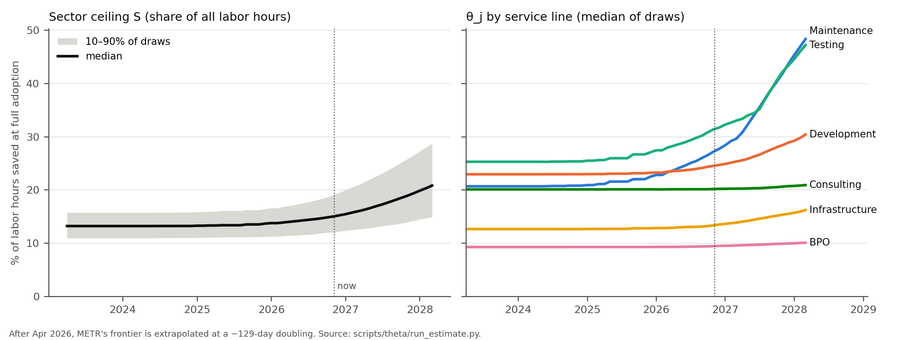
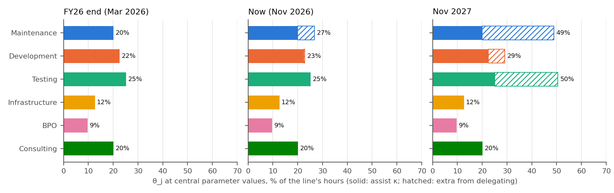
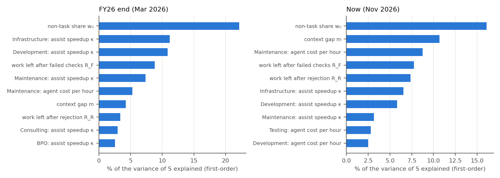

# Taking the θ model to the data: a first pass

*7 November 2026. Model: `04_theta_model/theta_model_text.md`. Code: `04_theta_model/scripts/` (`run_estimate.py`, then `figures.py`). Inputs and sources: `research/*.md` and `04_theta_model/theta_j_literature.md`.*

**TL;DR**

- With the inputs we have, the full-adoption ceiling is about **14% of labor hours at the end of FY26** (10–90% of draws: 11.5–17%), about **15% now** (12–19%), and about **19% by November 2027** (14–26%) if METR's trend holds.
- Almost all of it is *assisting*. At central values, delegating whole tasks didn't pay anywhere through FY26, and today it pays only on about a quarter of maintenance hours. That's mostly because agent runs are expensive relative to Indian wages: at US wages the same model delegates most maintenance work already.
- At disclosed adoption (about 22% of staff actively using AI tools by the end of FY26), the model gives about **3 points** of realized replacement over FY24–26 (2.4–4.1). The top-down estimate is about **7** (4.5–11). So the bottom-up explains roughly half. The most likely reason is that our κ, taken from 2022–24 tools, is too low for current ones.
- The inputs that matter most are the non-task share of hours, the context gap $m$, agent cost, and the work left after a failed or rejected attempt. Task-length distributions matter less than we expected.

## What we did

We coded the model in the memo exactly as written and drew each parameter from a prior (6,000 draws). The priors come from the literature review and three new searches. Each search wrote up its sources in `research/`.

| Input | What we used | Source | Confidence |
|---|---|---|---|
| $p_{\text{METR}}(h,t)$ | Measured frontier up to Feb 2026 (Opus 4.6: 12 h); extrapolated after, with a 104–158 day doubling; slope β 0.6–1.0; ×0.5–1.0 correction for fit choices and public-task overfit | METR TH1.1 file; Barry (METR 2026) | Medium. METR stopped updating in Sept 2026, so "now" is an extrapolation (central 23 h) |
| $m$, $k$, $q_0$ | $m$ 1–10, $k$ 2–10, $q_0$ 0.85–1 (all lines) | METR contractor/maintainer gap; Whitfill et al. | Low |
| Domain divisor | 1 for software lines; IT ops ÷3–40; BPO ÷10–100; consulting ÷2–20 | Kwa & Cheng; ITBench-AA; τ-bench; OSWorld 2.0; RLI | Low |
| $f_j(h)$ | Lognormal task touch times, e.g. maintenance median 1 h (σ 1.35), development 8 h (σ 1.5), BPO 9 min (σ 1.1) | Jira worklogs (SiP, MariaDB, Red Hat, Atlassian), MetricNet, call-centre data | Medium for software, low for testing, BPO back office, consulting |
| $\kappa$ | 0.10–0.35 by line (BPO 0.04–0.15) | Cui et al., Google RCT, Brynjolfsson et al. | Medium for 2022–24 tools; unknown for current ones |
| Review, $R$ | $\rho_A = a/h + b$ with $a$ 2–15 min, $b$ 0.05–0.25 (lower for BPO); $R_R$ 0.33–1; $R_F$ 0.8–1.1 | GDPval, Google, CUPS, Rein | Low |
| $\omega$, $c_D$ | Wage \$8–17/h for IT lines (offshore-heavy), \$2.5–5/h BPO; agent \$0.7–10 per human-hour of task for coding, up to \$30 for computer use | FY26 filings; OSWorld 2.0, MirrorCode, METR runs | Medium for wages, low for agent cost |
| $w_j$, $w_0$ | Big-four revenue splits converted to hours; non-task share 15–35% | `data/tidy/panel_long.csv` | Medium; splits end FY17–FY21 |

## Results

### 1. The ceiling, and how it moves

| | End FY26 | Now | Nov 2027 |
|---|---|---|---|
| Maintenance | 24% (14–35) | 27% (15–44) | 42% (18–60) |
| Development | 24% (17–30) | 25% (18–32) | 29% (19–46) |
| Testing | 28% (18–39) | 31% (19–49) | 43% (21–62) |
| Infrastructure | 13% (7–19) | 13% (7–19) | 15% (7–32) |
| BPO | 10% (5–14) | 10% (5–14) | 10% (5–15) |
| Consulting | 20% (12–28) | 20% (12–28) | 21% (12–29) |
| **S (all hours)** | **14% (11.5–17)** | **15% (12–19)** | **19% (14–26)** |

Medians, with the 10–90% range of draws in brackets. $S$ is lower than the line averages because 15–35% of hours are non-task time.

The ceiling was flat until 2026 and is only now starting to rise. Most of the rise to 2027 is maintenance and testing, which have short tasks and run on software, where METR's horizons apply directly.

### 2. Why delegation barely pays yet

Three things squeeze the delegate option from both ends of the task-length distribution:

- **Short tasks.** A fixed review cost per change (2–15 minutes) is a big share of a 20-minute ticket, so assisting wins.
- **Long tasks.** Most *hours* are in long tasks, even when the typical ticket is short: for maintenance, about 43% of hours are in tasks over 8 hours. After the context and reviewer discounts ($D = mk \approx 14$ at central values), the horizon that matters for accepted work at the end of FY26 was about half an hour. Long tasks mostly fail.
- **Agent cost against Indian wages.** This is the binding constraint in the middle. A coding agent at about \$2.60 per human-hour of task against an offshore wage of about \$12 means delegating has to save over a fifth of the task's hours *beyond* what assisting saves. At central values it doesn't.

Two what-ifs show how much this matters (central values, end of FY26 → now):

| Scenario | $S$ | Share of maintenance hours delegated |
|---|---|---|
| Central | 13% → 14% | 0% → 26% |
| US-like wages (×6) | 16% → 18% | 87% → 97% |
| No context gap, mild review ($m = 1$, $k = 2$) | 16% → 19% | 44% → 75% |
| κ 0.15 higher on every line | 24% → 24% | 0% → 0% |

So the same AI saves more labor at a US firm than at an Indian one, for now. Inference cost is an India-specific brake on delegation, and it will ease as agent prices fall.

BPO and IT ops get no delegation at all. Their horizons are 10–100× shorter than software's, and for BPO the cost of a computer-use agent is above the \$3/h wage. Firms do report real automation in these lines (30% of incidents auto-resolved at one HCLTech client, 55–80% of chats at AI-first companies). That suggests the domain divisors are too pessimistic for scripted, high-volume work, or that this automation runs on rules and workflow tools rather than on agents doing open-ended tasks.

### 3. Checking against the top-down estimate

The top-down estimate is about 2.3 points a year over FY24–26, or about 6.9 points cumulative (4.5–10.8). In the model, realized replacement is $\sum_j w_j A_j \theta_j$, so we need adoption.

- **What adoption would it take?** For the ceiling at the end of FY26 to deliver 6.9 points, about **49%** of task hours would need to be worked with AI by then (32–77% across the top-down range and model draws).
- **What adoption do firms disclose?** Active use of AI tools was about **22%** of headcount at the end of FY26 (15–30%). Wipro had 24.8% of staff on AI developer tools (20-F); Infosys had 9% of staff on GitHub Copilot. Disclosed shares were about 3% at the end of FY24 and 12% at the end of FY25.
- **So the model gives about 3.1 points** (2.4–4.1) by the end of FY26, roughly half the top-down figure. Concentrating adoption in the software lines (at twice the rate of the others) barely changes it: 3.4 points.

This isn't a rejection: the top-down estimate's sampling-noise range (−0.8 to 7.1 points a year) easily covers 1 point a year. But it is a consistent gap, and there are three candidate explanations:

1. **κ is too low for current tools.** Our κ comes from 2022–24 autocomplete tools. Tech Mahindra reports a 7% "AI-led" productivity gain across its programmes in FY26, when about 20–25% of staff were active users. That's about 28–35% per active user, above our 10–30%. Raising κ by 0.15 lifts the bottom-up figure to about 5.4 points, close to the top-down. This is the explanation we find most plausible, and it is directly testable.
2. **The top-down estimate picks up non-AI efficiency.** It compares FY24–26 with each firm's FY16–20 trend. A post-COVID push on utilization, pyramids or bench time would show up as "replacement" too.
3. **Disclosed adoption understates use.** It counts licensed coding tools, not staff using ChatGPT or Claude on their own.

### 4. What drives the uncertainty

At the end of FY26, the non-task share $w_0$ and κ by line explain most of the variance in $S$, because the ceiling is almost all assisting. Now, the delegation parameters take over: the context gap $m$, agent cost for maintenance, and the work left after failed or rejected attempts ($R_F$, $R_R$).

For the data request to firms, that suggests this order:

1. Hours by activity, including non-task time ($w_0$, $w_j$).
2. κ for current tools, by line: assisted vs unassisted effort on comparable tickets.
3. For delegated tickets: whether automated checks passed, whether the reviewer accepted, review time, and the hours spent finishing rejected work ($\pi$, $\rho$, $R$, and through them $m$ and $k$).
4. Agent spend per ticket.

The per-ticket effort logs for $f_j(h)$ matter less than we expected. The open-source worklogs already pin the shape down reasonably well for software (σ 1.2–1.9 in every sample).

## Caveats

- **"Now" is an extrapolation.** METR has no horizons for models after May 2026, and GPT-5.6 Sol's tentative estimate (about 11 h, CI 5–40 h) sits *below* the trend. If the trend has slowed, the 2027 numbers are too high.
- **The non-coding lines rest on guesses.** No benchmark for IT ops or customer support records human task times, so their domain divisors are assumptions.
- **Failed attempts give a head start.** $R_F$ averages 0.95, so a failed attempt still saves 5%. When agent cost is near zero, the model therefore delegates even hopeless tasks. Agent cost screens this out at realistic prices, but if agents became nearly free it would overstate delegation.
- **The weights are old.** The revenue splits end in FY17–FY21. The conversion from revenue to hours uses billing-rate ratios we assumed.
- **Adoption is a single number in the check.** A real validation would model $A_j(t)$ by line and quarter and compare year by year, not just the end point.
